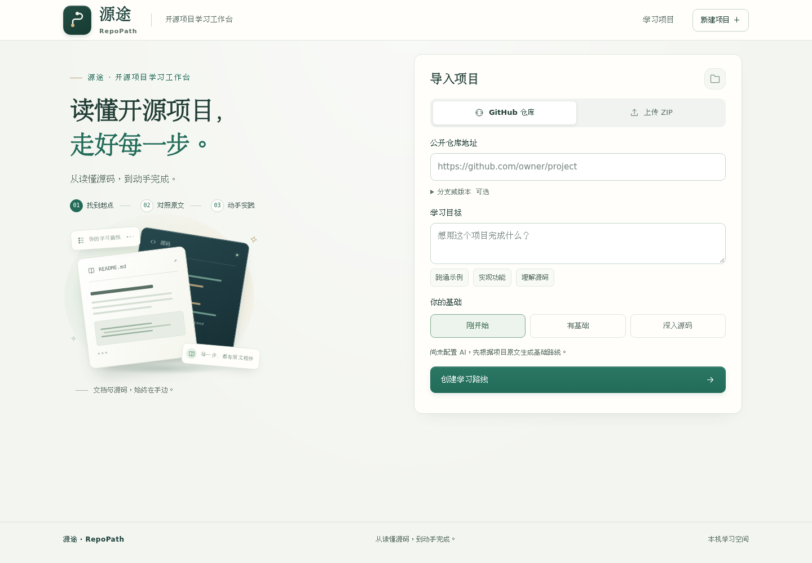

# 源途 · RepoPath

**面向开源项目的 AI 学习工作台。** 从读懂源码，到动手完成。

把开源项目原文变成可以逐步完成的学习任务。导入公开 GitHub 仓库或源码 ZIP，填写学习目标，在同一个工作台查看路线、阅读原文与源码、提问排错、记录笔记，并在下次打开时继续学习。

面向 AIC 2026「AI+开源」的 **AI开发工具与开源协作** 方向。公开仓库：<https://github.com/Luqhhh/opensource>。自主代码采用MIT；第三方材料保留原许可证。



界面图来自关闭 AI 的本机应用导入页，仅展示产品界面；没有真实模型调用，也不属于用户研究。

## 快速开始

需要 Python 3.10+。**运行环境为 macOS / Linux / WSL**：项目读取文件时使用 O_NOFOLLOW 等 POSIX 语义，Windows 原生环境无法启动，请在 WSL 中运行。

### 最短复现（不安装依赖）

`sh
git clone https://github.com/Luqhhh/opensource.git
cd opensource
python3 -m repopath learn --provider none
`

打开 <http://127.0.0.1:8765/>，导入一个项目 ZIP 或公开仓库地址，写一句具体目标即可。核心服务只用 Python 标准库，无需 pip install、无需模型、无需联网。

跑一遍回归测试：

`sh
python3 -m unittest discover -s tests -v
`

复核本报告的实验记录（只校验哈希与已存结果，不调用模型、不执行归档代码）：

`sh
python3 docs/evidence/semantic-v5-1p5b/verify_evidence.py
`

### 安装为命令

需要Python 3.10+：
```sh
git clone https://github.com/Luqhhh/opensource.git
cd opensource
python3 -m venv .venv
# Linux / WSL
. .venv/bin/activate
# Windows PowerShell 使用 .venv\Scripts\Activate.ps1
python -m pip install .
repopath learn --provider none
```

打开 <http://127.0.0.1:8765/>。上传项目ZIP或填写公开仓库地址，输入具体目标，例如“用TinyDB保存两条记录，按条件查询并验证重新打开后仍有数据”。基础路线无需模型，支持原文阅读、笔记、进度和导出。

在源码目录也可直接运行 `python3 -m repopath learn --provider none`，无需安装第三方Python运行依赖。

项目已由「例证 · ExampleProof」更名为「源途 · RepoPath」，安装包名称为 `aic-repopath`。已有环境升级时，先卸载 `aic-exampleproof`，再安装当前源码或新 wheel，避免两个安装包共享内部文件。旧的 `exampleproof` 命令仍可使用；学习数据目录、配置文件和 `EXAMPLEPROOF_*` 环境变量继续沿用，已有记录无需搬迁。详见[品牌与升级说明](docs/branding.md)。

## AI学习支持

维护者也可通过共享代理统一提供额度，克隆者无需 DeepSeek API Key：设置 `EXAMPLEPROOF_GATEWAY_URL` 为维护者提供的 HTTPS 地址，邀请码模式再设置 `EXAMPLEPROOF_GATEWAY_TOKEN`，然后运行 `repopath learn`。维护者部署、调用限额及随仓库发布默认服务地址的步骤见[共享 AI 代理](docs/shared-gateway.md)。当前仓库未配置公共代理地址，不能据此认为服务已经上线。

在启动服务的终端配置自己的 `DEEPSEEK_API_KEY` 后运行 `repopath learn`。本地模型使用：

```sh
repopath learn --provider ollama --model YOUR_LOCAL_MODEL
```

配置云端模型后，导入页的“自动用AI细化学习路线”会使用目标和经脱敏的项目片段。可取消勾选，仅生成基础路线。问答、排错和重新规划各自显示发送预览，确认后才发出请求。不要把密钥写进项目、目标或截图。

模型失败时保留基础路线和错误记录。引用帮助核对回答，但引用存在不代表回答正确；AI反馈和自行勾选的进度不证明已经掌握知识。

## 一次学习如何进行

1. **说明目标**：导入项目，选择基础水平，说清想完成的事情。
2. **开始任务**：查看“现在做”、操作位置和完成标志，打开对应原文。
3. **理解与排错**：解释片段、提问或粘贴实际报错，回答和引用保存在任务旁。
4. **记录与调整**：写笔记、做练习、拆分或跳过任务；调整可撤销。
5. **继续学习**：保存进度，关闭后重开，恢复学习记录；需要时导出指南或记录。

可选Python运行检查需要Linux、Bubblewrap和 `/usr/bin/python3`。只执行用户明确提交的完整示例，项目副本只读、无网络、最多5秒，不安装依赖；沙箱不可用时停止。每次运行独立，文件和变量不跨运行保留。阅读与问答不依赖沙箱。

## 用户体验与开放复用

效果验证围绕真实读者任务和访谈展开：[试用方案、项目与指标](docs/user-study/README.md)。受访者无需填写模型评分表。卡点、完成情况、求助、耗时与主观体验由实际记录产生，未回收的数据保持空白。

- [受访者说明与任务卡](docs/user-study/participant-guide.md)
- [主持人手册](docs/user-study/facilitator-guide.md)
- [安装复现与维护计划](docs/reproduction.md)
- [完整学习入口说明](docs/learning-app.md)
- [技术报告与演示材料](docs/submission/README.md)
- [第三方资源与自主边界](docs/resources.md)

## 维护者工具

保留教程静态分析、受限任务验证和补丁导出，不自动改写原项目：

```sh
repopath doctor --json
repopath analyze /path/to/project --static --output /tmp/repopath-analysis
repopath task-init --help
repopath task-check --help
repopath task-improve --help
```

模型候选与调用者冻结的检查分开；既有断言和预期输出受到保护。通过有限检查的补丁仍需人工审阅。高级命令见 [教程分析](docs/next-stage.md)、[任务验证](docs/task-improvement.md)。

## 开发与边界

```sh
python3 -m unittest discover -s tests -v
EXAMPLEPROOF_SANDBOX_TESTS=1 python3 -m unittest discover -s tests -v
node tests/code_highlight.test.cjs
```

Python运行依赖为空，前端为本地HTML/CSS/JavaScript。Node仅用于开发检查。打包按实际源码和前端资源逐字节核对wheel、sdist与安装目录，并在仓库外启动学习入口。

服务只监听本机，适合单用户，没有公网账号隔离。项目输入有文件数、体积和类型限制；复杂文档渲染与跨语言语义导航有限。运行检查不支持联网安装、编译扩展和长任务。

工程测试、自动操作演示、实时模型调用和读者观察分别记录。历史原始记录保留原样；当前介绍以学习流程与用户体验为主。反馈使用 [Issues](https://github.com/Luqhhh/opensource/issues)，删除私人内容和凭据。开发约定见 [CONTRIBUTING.md](CONTRIBUTING.md)。

## 本地实验修复策略

新增显式可选的实验策略 [semantic-v5](docs/semantic-v5.md)：AI 从真实源码的接口替换或完整参数方案中选择，工具保留原输入并复验。源码使用线索、名称和报错接收者用于候选排序；不把它们当作语义证明。最新配对开发回归中，补丁确认修复从 v4 的 **15/18** 提高到 v5 的 **18/18**，正常对照均 **9/9**，请求从 **33** 降至 **28**；18 次运行仅对应六个已观察缺陷，不能估计未见项目总体效果。[完整迭代与扩展项目重测](docs/evidence/semantic-v5-1p5b/README.md)。默认策略仍为 legacy，旧版 [v3](docs/semantic-v3.md)、[v4](docs/semantic-v4.md) 及其历史记录保留。

历史 Mistune、Werkzeug 的四个扩展失败案例重测中，两组仍均为 **0/12**，正常对照均 **6/6**；多步骤版本迁移尚未改善。

需要修复可复用函数或增加局部适配函数时，可显式选择 `semantic-v3`：

```sh
python3 -m exampleproof repair examples/tutorial \
  --model YOUR_LOCAL_MODEL --repair-policy semantic-v3 \
  --max-attempts 3 --model-timeout 180 --output artifacts/live-semantic-v3
```

该策略从公开上下文中识别 `callable named NAME` / `function called NAME` / `名为 NAME 的函数` 等明确要求，并在执行前检查名称是否保留。仅识别原示例已有绑定，不读取隐藏检查推导要求。允许最多四个简单适配函数，函数体限局部赋值及末尾一个 `return`，其余断言、危险引用和对象写入限制继续生效。默认 `legacy` 和已有 `semantic-v2` 的严格结构规则保持原样。

新版默认温度 0.2、初始 seed 17、上下文上限 8192、每次生成上限 2048 token；后续 seed 随完整尝试次数递增。v3 使用源码 API 所属类提示、适配提示和 JSON Schema，总调用预算不变。请求仅保留最近两轮历史，完整记录仍写入报告；原样返回和仅改空白/注释的重复候选不会重复执行。具体模型效果以 [配对开发回归对比](docs/semantic-v3.md#实时对比入口) 的实际配置和已公开范围为准。

需要源码候选约束和局部行修改时，将上述 `--repair-policy` 改为 `semantic-v4`，并使用新的输出目录。候选只是待验证建议，仍须通过原来的隔离执行与行为检查。[使用与验证](docs/semantic-v4.md)

需要尝试参数顺序或仅限关键字参数迁移时，可选择 `--repair-policy semantic-v5`。原输入各使用一次且保持求值顺序，原断言和行为检查继续执行；动态或歧义签名回到原有修复路径。[v5 使用与限制](docs/semantic-v5.md)
