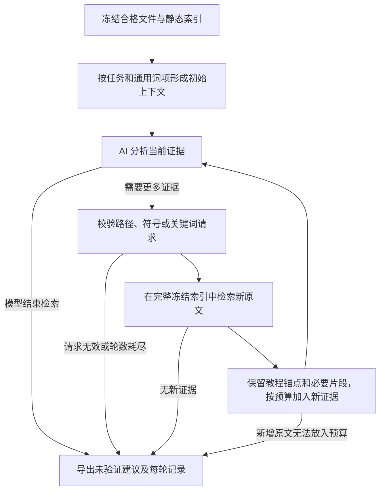

# 按证据缺口继续检索

`analyze --context-strategy iterative` 已实现一个受限的分析—检索—再分析循环。初始上下文仍由静态分块、Python AST 索引和词项排序产生，最多 40 个候选；可选 `--task` 将具体任务词项加入初始排序并传给每轮分析。模型可根据当前原文提出缺口查询，程序从整个冻结索引检索新片段，包含初始候选之外的文件及函数，再交给模型分析。



## 使用

```sh
# Ollama：模型必须已在本地安装
python3 -m repopath analyze /path/to/project \
  --provider ollama --model YOUR_LOCAL_MODEL --context-strategy iterative \
  --task '完成首次配置并调用依赖该配置的 API' \
  --include-tests --max-retrieval-rounds 3 --output /tmp/tutorial-local

# DeepSeek：首次只生成清单，不发送模型请求
python3 -m repopath analyze /path/to/project --context-strategy iterative \
  --task '完成首次配置并调用依赖该配置的 API' \
  --include-tests --max-retrieval-rounds 3 --output /tmp/tutorial-cloud

# 人工审阅 /tmp/tutorial-cloud-cloud-review.json 后重跑相同配置
python3 -m repopath analyze /path/to/project --context-strategy iterative \
  --task '完成首次配置并调用依赖该配置的 API' \
  --include-tests --max-retrieval-rounds 3 --output /tmp/tutorial-cloud \
  --approve-cloud REVIEW_SHA256
```

任务可省略，此时初始排序仍使用通用词项和文档标题。任务最长 2000 字符；不会从必要证据标注中读取任务或参考答案。默认策略仍是 lexical；ai 继续保持一次摘要筛选，compare 也仍只比较原来的两种策略。旧修复器、断言检查及 Markdown 正文编辑范围保持原有语义。

## 缺口协议与检索范围

模型每次返回现有的 findings、edits，并新增 evidence_requests 与 retain_ids。下面是协议格式示例，不是已执行的项目评测：

```json
{
  "findings": [],
  "edits": [],
  "evidence_requests": [{
    "kind": "symbol",
    "query": "Config.load",
    "reason": "需要核对配置加载时的默认值和错误行为"
  }],
  "retain_ids": ["c1"]
}
```

每轮最多三个请求，query 最长 240 字符、reason 最长 1000 字符；请求在任何查询执行前整体校验。支持：

- path：规范的仓库相对文件或目录路径，可附正整数 start_line，返回覆盖该行的原片段。不接受绝对路径、越界路径、URL 或反斜线。
- symbol：Python 函数或限定方法名，匹配静态 AST 索引中的标题。不导入模块；其他语言可使用 path/text。
- text：有限长度的字面文本及词项查询，按确定性的相关度排序，不作为正则、shell 或代码执行。

每个请求最多返回六个尚未展示的片段。同一查询仍能命中未展示内容时可继续取下一批；重复且没有新结果、仅命中已展示片段或没有索引命中时停止。每次都搜索同一份冻结索引，不重新遍历正在变化的磁盘，不下载依赖或获取新仓库。

默认最多补充三轮；可配置 1–5 轮，每次完整运行最多“补充轮数＋1”次模型请求，包含首次分析。没有额外的选择调用、隐式重试或备用服务。每次生成仍最多 2048 token；报告保存所有尝试的用量，任何未知用量都保持 null，不能把相同字符上限称为相同总 token 成本。

完整索引仍受输入策略、1000 文件、8 MB、4000 片段等既有限制。测试目录需显式 --include-tests；被过滤、超限、符号链接或未成功索引的内容不会因模型请求而自动开放。零命中只表示本次静态索引没有找到匹配，不能认定项目不存在相关实现或说明。

## 上下文与停止

每轮沿用 2000–48000 字符的证据数组上限。程序优先保留已展示的教程锚点及模型声明必要的 retain_ids，再放入新增命中，最后补入其他旧证据。retain_ids 最多十二个，必须来自当前已展示的 ID；旧证据可以被淘汰，以便新增证据进入。原片段只整块加入，不截取代码前缀冒充完整证据。

模型返回空 evidence_requests 时记录 model_finished；这只表示模型结束检索，没有独立证明证据已充分。达到轮数上限、没有新证据、预算放不下新增片段、请求无效或服务错误均有独立停止原因和警告。未解决的请求保留供人工检查，不自动改写为缺陷。

最终建议只能引用最终分析上下文中的 ID，不能引用仅命中但没有展示的内容。后续模型调用失败或返回无效缺口协议时，保留最后一次成功分析和与其对应的上下文，记录失败尝试；不拿旧建议去引用另一组新证据。正文编辑仍须精确匹配原文、保护代码和断言，补丁只导出供审阅。

## 云端审阅与记录

迭代模式的云端清单包含整个合格索引的脱敏可检索原文、文件摘要、初始候选 ID、提示词、任务的脱敏视图、轮数上限和查询限额。确认意味着允许后续轮次从该集合发送子集，不会一次性将全索引发送给模型。可用既有排除规则或自定义脱敏值缩小范围；自动脱敏仍需逐项人工复核。

每次发送的原文都必须等于冻结片段，并转换为已审阅的脱敏视图；查询也在这个视图上进行。任务及轮数变化后清单需要重新匹配。下一轮携带的检索请求必须来自上一条模型响应，结果 ID 只能指向已确认的索引片段，不能通过额外字段夹带任意原文。任何校验失败都在发送前停止。

analysis.json 保留全部模型调用、实际请求和用量。新增 retrieval.json 保存每轮上下文 ID、缺口、命中 ID、预算后的上下文、停止原因及相关原始片段映射；HTML 展示轮数和剩余待确认缺口。证据覆盖报告增加 retrieved 和 available_after_retrieval，分别标记命中片段与初始候选加命中的可用范围。报告始终区分初始候选与后续扩展。

这些都是本地产物；本地报告可能保留未经发送的原文，公开前仍需审阅。compare-audit 目前只审计原来的 lexical/ai 成对协议，不把它的通过状态套用于新的迭代记录。

## 验证边界

新增合成工程测试验证跨出 40 候选的连续两次缺口查询、路径/符号/文本查询、任务排序、原文一致性、预算内替换、轮数与重复停止、文件变化后的冻结索引、错误恢复、引用校验以及云端跨轮脱敏和确认绑定。没有执行输入项目或模型命令，没有发送真实模型请求，没有新增第三方依赖、模型或语料。

当前已实现检索闭环；真实项目的必要证据召回率、建议准确率、读者效率和相对成本仍需独立评测。既有实时模型或历史兼容性结果未重新运行，不能用它们作为新策略的成绩。

## 累计用量、硬时限与逐轮增益（本轮工程更新）

默认策略继续为 lexical，iterative 保持显式选择。新增两个可选参数：

```sh
python3 -m repopath analyze /path/to/project --provider ollama --model YOUR_LOCAL_MODEL \
  --context-strategy iterative --task '完成首次配置' \
  --max-total-tokens 32000 --deadline-seconds 120 --output /tmp/bounded-analysis
```

max-total-tokens 是模型返回的累计输入＋输出 token 停止阈值：达到阈值后不再发送下一请求，缺少任一用量也停止追加请求并保留 null。它不是服务计费硬上限，正在进行的一次请求可能超出阈值；不依赖未知分词器估算来保证收费。原有每次输出上限、字符上限与轮次上限仍保留。

deadline-seconds 是 CLI 输入获取、索引与分析过程的墙钟时限，使用 POSIX 主线程计时器中断阻塞请求。非 POSIX 或非主线程显式拒绝该选项，不静默退回无界等待。库函数 analyze_snapshot 的时限从分析入口开始，输入冻结时间由调用方另计。没有配置该参数时保持既有 socket 超时行为。模型阶段超时保留可用失败证据和上轮结果；输入准备阶段超时返回 2，不生成成功报告。到期后允许有限的失败记录清理/导出，不表示服务器已停止计费或工作。

云端审阅 SHA 同时绑定 token 阈值和时限；改变限制需新清单。retrieval.json 增加累计已知用量、停止原因和 elapsed_seconds。存在必要证据标注时，每轮记录当前覆盖、首次覆盖和相对上一轮丢失的跨度数；无标注则保持 not_measured，不能把新片段数当作有效证据增益。

这些约束由合成响应和阻塞调用测试验证，未作为新的真实任务收益结果。公平任务对照入口见 [任务评测](task-evaluation/README.md)，其中 lexical 与 iterative 使用相同任务和范围；普通 analyze 的 --task 仍限定于 iterative。
