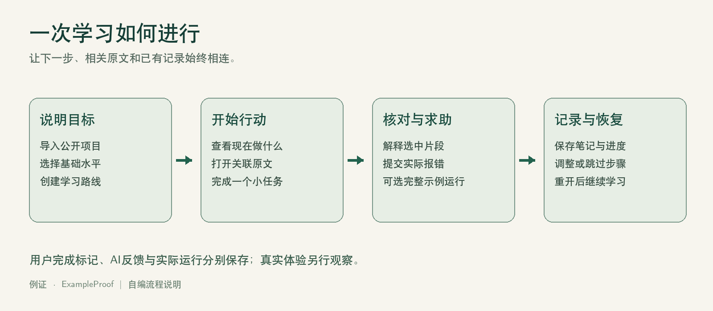
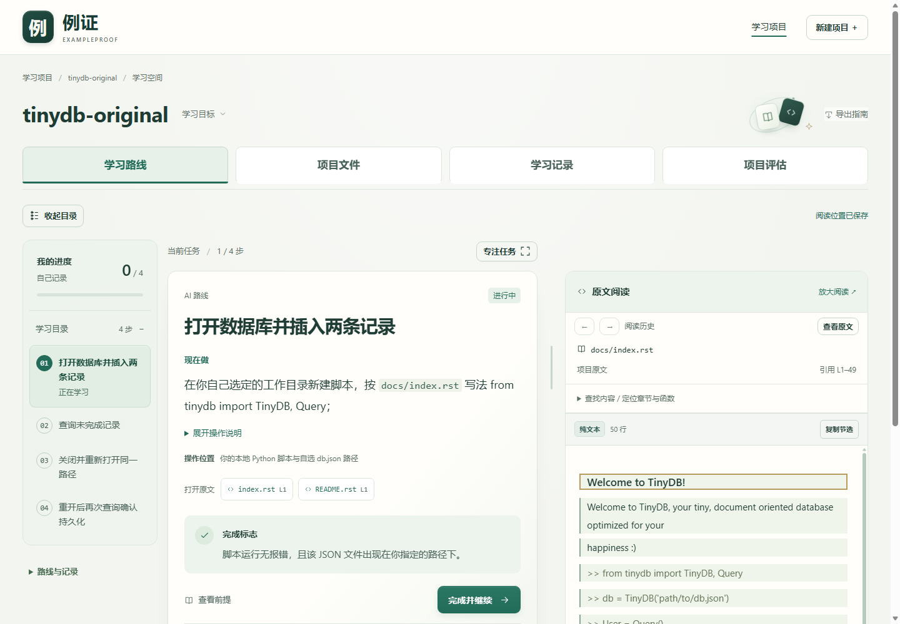
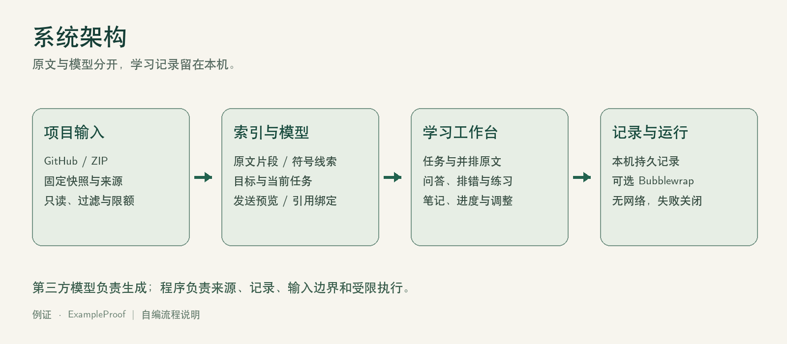

# 从陌生项目到可行动任务

学习者需要知道从哪里开始、原文如何对应当前步骤、遇到错误怎样继续，以及下次如何接着学。

例证把目标、任务、原文和学习记录放在同一个空间。

# 完整学习流程

# 实际工作台

任务动作、完成标志与原文一起呈现；笔记、问答和阅读位置可以恢复。

# AI与开源如何结合

模型理解目标并提供路线与解释；程序提供真实片段、引用绑定、持久记录和受限执行。

# 自主实现

- 目标驱动的任务与原文联动。
- 关联当前任务的问答、排错和继续追问。
- 版本化路线、笔记、讨论与可撤销调整。
- 输入过滤、发送预览与隔离执行边界。

# 真实用户体验

TinyDB：保存、查询、重新打开。

Schedule：注册、执行、按标签取消。

实际观察卡点、帮助、完成过程和中断恢复，访谈收集具体感受。试用材料已准备，真实记录回收后补充结论。

# 分工与工程交付

路庆浩：后端、模型接口、隔离衔接与安装检查。

肖金诺：学习交互、原文与记录、试用材料和演示表达。

共同梳理需求、复现问题、整理体验与复核材料；AI辅助过程单独披露。

# 开放与维护

公开仓库：github.com/Luqhhh/opensource

MIT自主代码、安装包、使用说明、任务卡和资源清单。

依据真实反馈优先完善保存、定位和失败恢复；第三方材料保留原许可。

# 适用边界

本机单用户；引用不自动证明回答正确；自行完成标记不证明掌握。

运行仅在受限环境中执行完整Python示例，无网络与自动依赖安装；不可用时停止。
