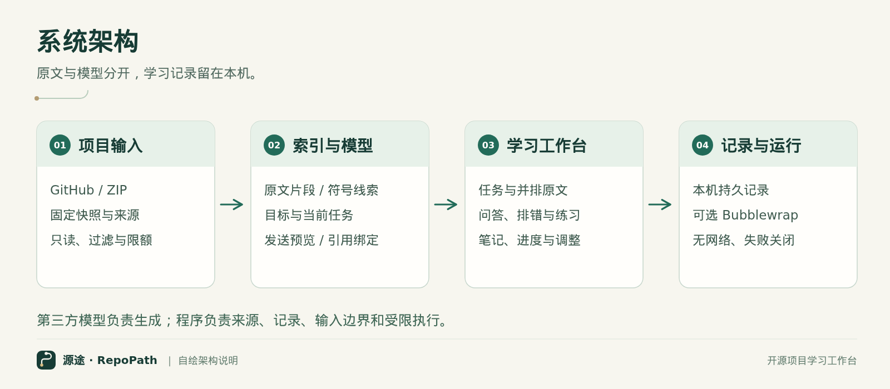
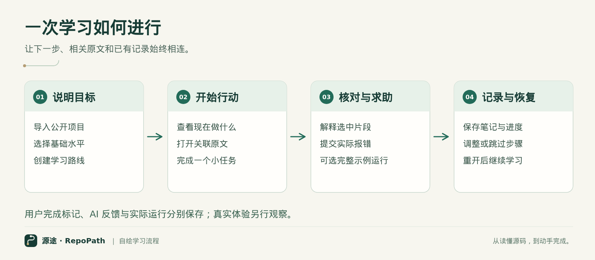
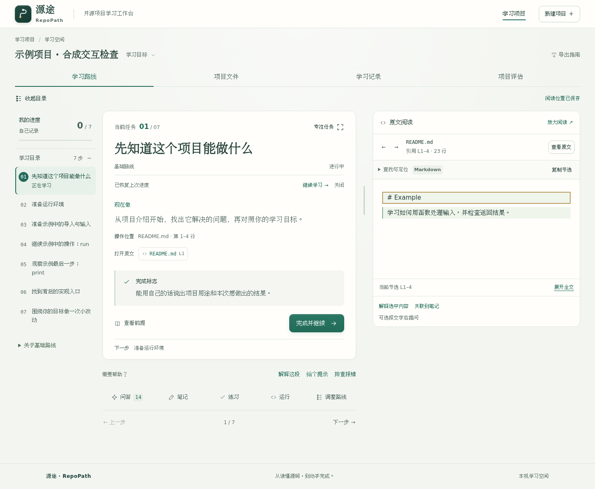

**参赛方向：AI开发工具与开源协作。成员：路庆浩、肖金诺。作品形态：本机运行的网页学习工作台与配套开发工具。**

# 1. 作品概述

学习者打开陌生开源项目后，需要在README、使用文档、源码和问答工具间来回寻找：从哪里开始、当前步骤需要什么前提、示例为什么报错，以及上次学到哪里。源途（RepoPath）把这些活动放入同一个任务空间，让学习者围绕明确目标逐步阅读、操作与记录。

用户导入公开GitHub项目或源码ZIP，填写目标和基础水平，获得带原文引用的学习路线。每个任务显示操作内容、位置和完成标志；旁边的阅读区可以打开文档与源码。问答、排错、笔记、练习和可撤销路线调整关联当前任务，关闭页面后仍可继续。

作品的目标是降低项目入门中的查找与衔接负担。当前已实现核心工作流程，实际使用价值通过真实读者任务和访谈收集；本轮用户记录尚未回收，不预报学习效果。

# 2. 需求与总体方案

## 2.1 目标用户与任务

主要用户是具有基础编程知识、希望实际使用一个陌生开源项目的学习者。典型任务包括用TinyDB保存与查询数据、用Schedule注册和取消提醒。项目维护者可复用原文定位、教程分析、任务验证和补丁导出能力。

现有做法通常由用户自行拆解目标、复制代码和组织对话。源途提供与项目原文关联的任务、上下文与持久记录，使“看说明—提出问题—继续操作”在同一位置衔接。这个设计差异需要用实际体验确认其价值，不预设优于其他工具。

## 2.2 架构与流程

{width=95%}

输入层读取固定快照并保留来源。索引层过滤敏感路径、限制大小，生成文档片段和Python静态符号线索。学习层把目标、基础水平和相关片段交给模型生成结构化路线；返回引用必须指向提供的原文。交互层负责任务、问答和阅读。记录层在本机保存路线版本、笔记、讨论、练习、运行与调整。

{width=95%}

基础路线不依赖模型。云端模型不可用时保留已有路线及错误。可选执行通过单独的隔离边界完成，不执行模型给出的系统命令。

## 2.3 成本与可运行性

核心服务使用Python标准库，前端使用原生HTML/CSS/JavaScript，无第三方Python运行依赖。阅读与基础路线可在普通电脑运行；AI可以调用用户配置的DeepSeek服务，或显式选择本地Ollama。项目未训练基础模型，不要求专用硬件。云端成本随实际请求产生，不预设免费额度；本地模型的硬件需要由所选模型决定。

# 3. AI与开源资源融合

模型承担目标理解、路线细化、当前任务解释、报错讨论和练习反馈。静态索引提供真实文档与源码片段；程序限制返回结构和引用，用户可以直接打开原文核对。模型输出与原文之间形成可检查的联系，而不是只保留一段脱离项目的聊天文字。

导入时用户选择是否自动细化路线。问答与重新规划分别展示实际发送预览；用户确认后发送经脱敏的项目片段与问题。基础路线、AI回答、用户完成标记与实际隔离运行记录分开保存。

本项目自主设计任务与阅读联动、版本化学习记录、问题上下文、精确发送绑定、输入限制和受限验证流程。基础模型、解释器、隔离工具和上游项目由第三方提供，保留其来源与许可。资源附件区分运行组件、可选服务、试用材料和构建工具。

# 4. 设计与实现

## 4.1 项目导入与任务工作台

GitHub导入解析到固定提交，ZIP导入检查路径穿越与符号链接，并限制文件数量和体积。项目内容只读，不自动安装依赖。文档与源码以有界片段进入索引，界面说明覆盖范围。

任务界面集中显示“现在做”和完成标志，原文并排展开；目录可收起，阅读区可调整宽度。代码支持本地词法着色、文件内搜索和有限符号定位；复杂格式可以切回原文。内部链接和阅读历史帮助用户在说明与实现之间移动。

{width=95%}

当前品牌采用「源途 · RepoPath」，标语为「从读懂源码，到动手完成。」界面以路径与节点标识表达逐步学习，延续象牙白、浅青绿和深绿操作色。上述截图来自合成浏览器夹具，展示当前界面与合成项目，不属于真实模型结果或用户研究。架构与流程图由本项目 SVG 源图生成，原始截图与录像另行保留。

## 4.2 提问、排错和恢复

问题携带当前目标、任务、选中原文和有限近期讨论。用户可继续追问指定回答，查看回答引用。准备和发送阶段避免重复请求；失败保留问题并允许重新预览。笔记、阅读位置和讨论存放在本机，刷新或重开后恢复。

路线调整支持跳过、拆分与补看前提，用户可以撤销；重新规划保留旧路线和原记录。跳过不计完成，自报完成也不自动推导掌握。

## 4.3 可选运行与维护者工具

运行入口接受用户明确提交的完整Python示例，最多5秒，项目副本只读、无网络、无自动依赖安装。执行器无法建立时返回受阻状态。每次执行独立，临时文件与变量不跨运行保存。

另保留教程分析、任务合同和补丁导出工具。候选不能放宽调用者冻结的检查、删除既有断言或改写预期输出。补丁先在一次性副本复查，再交给使用者审阅。学习入口的普通运行没有独立行为断言，因此执行结束不等于任务正确或知识掌握。

## 4.4 团队分工与AI辅助

两名成员均衡承担设计、实现、验证与材料工作，按以下安排推进，并共同复核关键改动。

- **路庆浩：** 项目输入与后端流程、模型接口、隔离运行衔接、安装发布检查。
- **肖金诺：** 学习工作台交互、原文阅读与学习记录、试用组织材料、演示表达。

两人共同承担需求梳理、问题复现、用户试用整理，以及报告与演示复核。

开发使用Codex辅助代码、测试、文档与演示制作；工具生成的实现通过源码检查和工程验证，生成的任务说明交给实际读者试用。AI参与部分不单独作为团队原创权利证明。人工阅读、修改和验证与工具生成分开记录，第三方资源保留原版权和许可。

# 5. 展示与真实用户体验

## 5.1 可演示流程

演示从导入项目和填写目标开始，依次展示路线、原文、提问、笔记、可选运行、保存和恢复。录像中的自动操作只用于展示实际应用流程，不算真实读者体验。模型模式与演示来源在画面中标明。

工程验证包括核心回归、实际Bubblewrap隔离、安装包资源一致性，以及仓库外的启动、ZIP导入、进度保存和导出。具体命令与结果随交付清单提供；这些检查支持可运行性，不替代用户感受。

## 5.2 真实读者任务

试用计划邀请6–8位具有基础Python知识的读者，每人使用一个不熟悉的项目，约30分钟完成导入、两个小任务和学习恢复。TinyDB任务围绕保存、查询和重开；Schedule任务围绕注册、一次执行与按标签取消。主持人记录真实帮助、卡点和环境问题。

记录包括独立或协助完成、未完成、环境受阻、退出，实际用时、求助和五项体验问题。访谈重点是何处帮助继续、何处困惑以及最希望改动什么。问卷和记录表与应用分开，避免增加学习界面的评审负担。

目前已准备受访者说明、主持人手册、项目包和空白记录表。实际记录回收后，报告将以匿名过程、经同意的引语和改进闭环展示效果。未回收前不填写参与人数、满意度或改善幅度。

# 6. 创新与开放复用

源途的设计集中在三个环节：把项目原文组织为可行动任务；让问题、引用和排错持续关联当前任务；让记录、路线变化和恢复跨页面保留。受限运行进一步帮助用户观察示例，但保持与理解判断的边界。

| 学习需要 | 常见操作 | 源途的设计 |
| --- | --- | --- |
| 找到开始位置 | 自行阅读文档目录并拆解目标 | 按目标形成步骤并链接原文 |
| 理解当前步骤 | 复制原文到另一个问答窗口 | 在任务旁携带片段和有限讨论 |
| 错误后继续 | 重新描述环境与上下文 | 保存报错、环境和关联讨论 |
| 中断后恢复 | 手工找回文件、问题与进度 | 保留笔记、阅读位置和路线版本 |

表格描述功能流程差异，不给其他产品排名。公开仓库、安装包、试用材料与资源说明可供学习者和维护者复用。后续按真实反馈优先修复保存、定位、入口和失败恢复问题，计划每两周整理问题与文档；维护节奏依成员实际情况调整。

# 7. 安全与适用边界

服务监听本机回环地址并检查请求来源，适合单用户，不具备公网多租户隔离。公开源码不代表其中所有内容都可任意再分发，随附项目材料保留来源与许可证。用户问题与片段只按选择进入云端；自动脱敏仍需用户检查。

引用校验不能证明回答语义正确。有限文档渲染、跨语言导航、运行环境和输入大小会限制适用范围。隔离执行不提供联网安装；同进程行为检查也不是对任意恶意代码的完整安全证明。产品不会自动应用补丁或向上游发送内容。

# 8. 开放成果与后续工作

公开仓库：<https://github.com/Luqhhh/opensource>。安装与复现说明见仓库README和 `docs/reproduction.md`；反馈入口为仓库Issues。自主代码采用MIT，第三方资源按附件列明的许可处理。

下一步以真实用户体验形成“观察—改动—回访”记录，优先解决具体任务中的障碍。作品的完成状态以交付文件和实际运行记录为准，用户体验结论在真实记录回收后补充。
